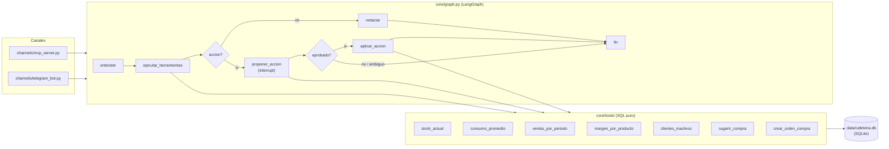

# Cafetería Copilot

Copiloto de operación para una cafetería saludable: responde preguntas de
negocio (stock, ventas, márgenes, clientes) sobre datos reales de la
cafetería y propone órdenes de compra que un humano aprueba antes de que se
registren. No es un punto de venta, no toma pedidos ni cobra: es una capa de
consulta y decisión sobre los datos que el negocio ya genera.

> Los datos de este repo (`data/cafeteria.db`, generados por
> `scripts/seed.py`) son sintéticos a propósito.

## Arquitectura

Cuatro capas con dependencia en una sola dirección: los canales dependen del
grafo, el grafo depende de las herramientas, las herramientas dependen de los
datos — nunca al revés (regla 7 de `CLAUDE.md`).



El único camino de escritura (`crear_orden_compra`) se ejecuta después de un
`interrupt()` del grafo: nunca antes de una aprobación humana explícita
(regla 6). El servidor MCP (`channels/mcp_server.py`) solo expone las 6
herramientas de lectura — `crear_orden_compra` queda fuera a propósito
(regla 5).

## Evaluación (`evals/`)

`evals/dataset.yaml` tiene 15 casos fijos (stock, ventas, márgenes, clientes
y 2 casos ambiguos) con respuesta esperada. `py -m evals.run_evals` los
corre contra el grafo real y mide dos aciertos por separado: **herramienta**
(¿llamó la correcta?) y **valor** (¿el número en la respuesta final es el
esperado?).

### Antes / después de la tarea 1.18

La tarea 1.18 arregló fallos de enrutamiento (no de redacción) encontrados en
la corrida inicial (1.17). El caso **V3** necesita dos lecturas porque su
15/15 final no viene de un cambio en el agente, sino de corregir una
pregunta ambigua del dataset — ver el detalle completo en
[`evals/resultado_final_1.18.md`](evals/resultado_final_1.18.md).

| Corrida | Herramienta | Valor | Qué cambió |
|---|---|---|---|
| Línea base (1.17) | 13/15 | 12/15 | — |
| Paso 1: grading de `conteo` cuenta ítems mencionados, no solo el número literal | 13/15 | 13/15 | C1 pasa (era fallo del evaluador) |
| Paso 2: refuerza que un período ausente se pregunta, no se inventa | 14/15 | 13/15 | A1 pasa |
| Paso 3: documenta que `clientes_inactivos` trae `compras_totales`/`ticket_promedio` | 15/15 | 14/15 | C2 pasa |
| **Techo real del agente — V3 con su pregunta original** | 15/15 | **14/15** | V3 sigue fallando: ambigüedad real de la pregunta, no un bug |
| **Final — V3 con la pregunta corregida** | 15/15 | **15/15** | V3 pasa |

La pregunta original de V3 era *"¿Qué categoría de productos vendió más en
julio 2026?"* — el agente respondía consistentemente con la categoría de más
**unidades** (café), y el dataset esperaba la de más **ingresos** (batido).
No es un fallo del agente: es la misma ambigüedad que V4 ya evitaba pidiendo
"ingresos" explícito. Se corrigió la pregunta del dataset para pedir lo
mismo, no el comportamiento del grafo. Cualquier comparación futura contra
este resultado debería aclarar cuál de las dos lecturas de V3 está usando.

### Criterio: cuándo pedir aclaración

| Caso | Pide aclaración | Por qué |
|---|---|---|
| **A1** — falta el período ("¿cómo van las ventas?") | **Sí** | Sin período, cualquier respuesta contesta algo que nadie preguntó. Adivinar un rango y dar un número real de un período no pedido es peor que preguntar de más: la dueña no puede confiar en una respuesta a otra pregunta. |
| **A2** — dos proveedores con compras pendientes a la vez | **Sí** | Ejecutar la orden del proveedor equivocado es una acción real e irreversible. |
| **V3** — "vendió más" ambiguo entre ingresos y unidades | **No** | El período y la herramienta ya son correctos; la duda es solo qué métrica priorizar, y ambas vienen juntas en el mismo resultado. Cualquier interpretación razonable sigue siendo información útil, no un dato inventado ni una acción irreversible. |

**Regla general:** pedir aclaración cuando adivinar puede (a) devolver un
dato que no corresponde a nada que se pidió, o (b) ejecutar una acción
irreversible sobre la elección equivocada. No pedirla por una variación de
fraseo cuando toda interpretación razonable sigue siendo útil — eso solo
agrega fricción a preguntas que un dueño de negocio haría sin pensarlas dos
veces.

### Costo y latencia (Langfuse, tarea 1.19)

Corrida real de los 15 casos con trazas de Langfuse activas (contenedor
local, ver [`LANGFUSE.md`](LANGFUSE.md)). El costo se calcula localmente a
partir de tokens reales de Gemini × precio oficial de `gemini-2.5-flash`
(detalle completo en [`evals/costo_1.19.md`](evals/costo_1.19.md)):

- **Costo total:** $0.013018 (15 consultas)
- **Costo promedio por consulta: $0.000868**
- **Latencia promedio por consulta:** 8.40s

La latencia es casi toda la llamada al modelo, no el trabajo del grafo
alrededor: en una traza individual típica, de 9.49s de duración total del
grafo, **9.18s corresponden a la llamada a Gemini** (nodo `entender` o
`redactar`) — el resto (parseo, SQL de las herramientas, armado del prompt)
es marginal en comparación.

> 📸 **Captura pendiente:** traza de Langfuse mostrando el desglose de
> tiempo por span (llamada al modelo vs. resto del grafo).

## Cómo levantar el proyecto

```bash
py -m venv .venv
.venv\Scripts\activate

py -m pip install -r requirements.txt

copy .env.example .env
# completar GEMINI_API_KEY en .env (obligatoria); GEMINI_MODEL es opcional

py -m scripts.seed          # genera data/cafeteria.db con datos sintéticos
py -m pytest -q             # pruebas unitarias (excluye las que llaman a Gemini)
```

Para correr el grafo completo contra Gemini de verdad (clasificación de
intención de `tests/test_graph.py`, cuestan dinero):

```bash
py -m pytest -q -m api
```

Para correr el dataset de evaluación:

```bash
py -m evals.run_evals
```

Langfuse (trazas de costo/latencia) es opcional: sin
`LANGFUSE_PUBLIC_KEY`/`LANGFUSE_SECRET_KEY` en `.env`, el grafo funciona
igual pero sin trazas. Instrucciones para levantarlo en
[`LANGFUSE.md`](LANGFUSE.md).

## Servidor MCP (`channels/mcp_server.py`)

Expone las 6 herramientas de lectura (todo menos `crear_orden_compra`, que
solo se ejecuta vía el grafo con aprobación humana) para que un cliente MCP
las descubra y llame directamente.

### Levantarlo

```bash
iniciar_mcp.bat
```

El `.bat` activa el entorno virtual del repo y corre
`py -m channels.mcp_server` — usarlo así en vez del comando directo evita
tener que activar `.venv` a mano cada vez que un cliente MCP lo lanza.

### Conectarlo a un cliente MCP en Windows

Ejemplo para Claude Desktop: editar (o crear)
`%APPDATA%\Claude\claude_desktop_config.json` y agregar una entrada bajo
`mcpServers` que apunte a la ruta absoluta del `.bat` en este repo:

```json
{
  "mcpServers": {
    "cafeteria-copiloto": {
      "command": "C:\\ruta\\completa\\a\\cafeteria-copilot\\iniciar_mcp.bat"
    }
  }
}
```

Reiniciar Claude Desktop después de guardar. Si la conexión anduvo, el
cliente lista las 6 herramientas (`stock_actual`, `consumo_promedio`,
`ventas_por_periodo`, `margen_por_producto`, `clientes_inactivos`,
`sugerir_compra`) y puede llamarlas en una conversación normal.

> 📸 **Captura pendiente:** conversación con el cliente MCP mostrando una
> pregunta resuelta con una de estas herramientas.

## Estructura

```
core/
  config.py        carga de variables de entorno (.env)
  db.py             conexión y DDL
  models.py         modelos Pydantic de entrada/salida de herramientas
  tools/            una herramienta por archivo, SQL puro, sin LLM
  graph.py          el grafo LangGraph
channels/
  mcp_server.py     expone las herramientas de lectura por MCP
  telegram_bot.py   bot con botones de aprobación (fase 2)
evals/
  dataset.yaml      preguntas de prueba con respuesta esperada
  run_evals.py      corre el dataset y escribe la tabla de resultados
scripts/
  seed.py           genera datos sintéticos
data/               la base de datos (en .gitignore)
tests/              pruebas unitarias de herramientas
```

Reglas completas del proyecto (qué calcula el modelo, qué no, aprobación
humana, dirección de dependencias) en [`CLAUDE.md`](CLAUDE.md). Modelo de
datos y alcance funcional en [`SPEC.md`](SPEC.md).
